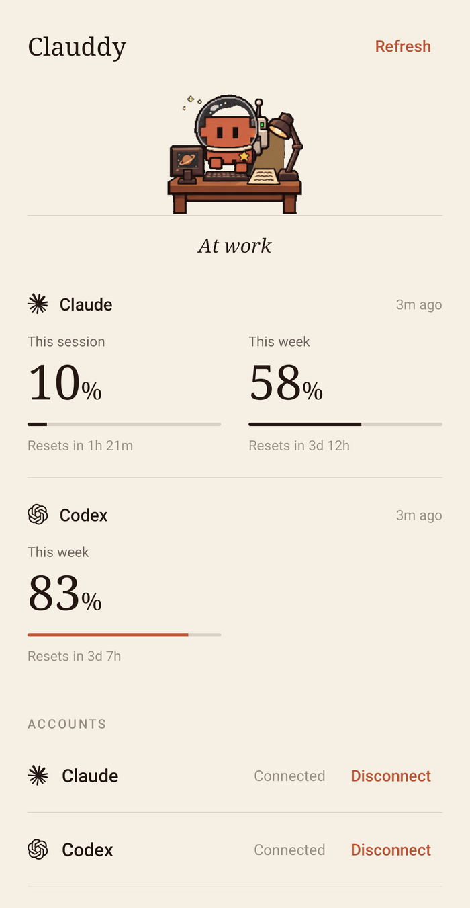
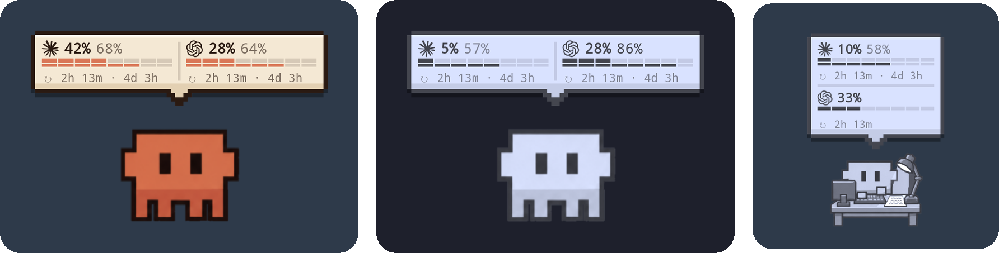

# Clauddy for Android (prototype)

An unofficial Android port of Clauddy, the desktop pet from Renato Augusto's [claude-usage-monitor](https://github.com/renatoaug/claude-usage-monitor). The pet, its moods, the bubble and the alert rules all come from there; this repo adds the phone side: a home-screen widget, the logins and the background readings. It isn't affiliated with the original project.

<p align="center"></p>



<sub>Rendered from the app's own drawing code by the test suite (`HomeShotTest`, `PetArtTest`), with sample readings.</sub>

A home-screen widget with the Clauddy pet and its glance: for Claude and Codex, the session % and the weekly % beside it, read from the account every 15 minutes, with notifications at 90%, at the limit and when a hot session resets.

It logs in like the desktop Clauddy (OAuth with PKCE, the same public client as Claude Code): tap **Connect**, log in, copy the code, paste it back. A token from `claude setup-token` works too.

Codex logs in with your ChatGPT account through OpenAI's device code: the app shows a code, you approve it on OpenAI's page, nothing is pasted back.

The phone sees only each account's limits, not the computer's local logs, so "at work" is read off the session % going up between readings.

Both logins use the public clients of Claude Code and the Codex CLI. Tokens are kept in the app's private preferences (not encrypted) and excluded from backups and device transfers.

Pet art and design from [claude-usage-monitor](https://github.com/renatoaug/claude-usage-monitor) by Renato Augusto, used under its MIT license (see [LICENSE](LICENSE)).

## Build

```bash
JAVA_HOME=/opt/homebrew/opt/openjdk@21 ./gradlew testDebugUnitTest assembleDebug
```

The APK lands in `app/build/outputs/apk/debug/`; `build/pet-art/` under `app/` holds the widget rendered in each state.
